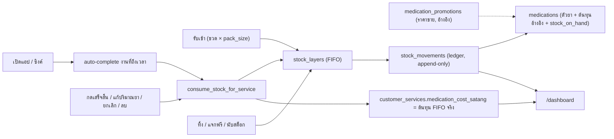
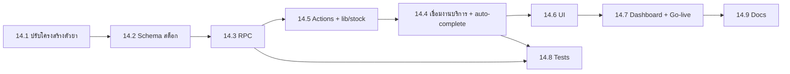

# Phase 14: ระบบจัดการสต็อกยา (Medication Stock Management)

> สรุปจากการคุย (grill-me) วันที่ 2026-11-05 · ไฟล์นี้คือรายละเอียดของ Phase 14 ใน `BACKLOG.md`

## ข้อตัดสินใจ (Decision Log)

| # | หัวข้อ | ข้อสรุป |
|---|---|---|
| D1 | หน่วยที่นับ | นับเป็น**หน่วยที่ใช้จริง** (ยูนิต/ml/เม็ด) ตอนรับเข้าให้กรอกจำนวนขวด/กล่อง แล้วระบบคูณกับ `pack_size` ให้เอง |
| D2 | Lot / วันหมดอายุ | ไม่ต้องเก็บ ผู้ใช้เห็นแค่ยอดรวม |
| D3 | ต้นทุน | ระบบเก็บชั้นต้นทุน (cost layer) ของการรับเข้าแต่ละครั้งไว้เบื้องหลัง แล้วตัดแบบ **FIFO** |
| D4 | จังหวะตัดสต็อก | ตัดเมื่องานบริการเป็น `completed` และคืนสต็อกเมื่อยกเลิก ลบ หรือย้อนกลับเป็น `upcoming` |
| D5 | ปิดงานอัตโนมัติ | ผู้ใช้ไม่ค่อยกด "เสร็จสิ้น" จึงให้ระบบปิดงานที่ถึงวันเวลาแล้วเป็น `completed` (และตัดสต็อก) **ตอนเปิดแอปหรือซิงค์** โดยยังกดย้อนกลับได้ |
| D6 | แก้ปริมาณยาหลังงานเสร็จ | แก้ได้**เฉพาะ `medicationUsages`** ภายในเดือนปัจจุบันและ 7 วันแรกของเดือนถัดไป (ช่วงผ่อนผันเดียวกับ Phase 12) ระบบจะคืนสต็อกแล้วตัดใหม่ให้เอง |
| D7 | เศษยาในขวดที่เปิดแล้ว | ไม่ต้องจัดการ เพราะใช้เศษต่อกับลูกค้าคนถัดไปเสมอ |
| D8 | ประเภทการเคลื่อนไหว | รับเข้า · ใช้กับลูกค้า · ทิ้ง/เสีย/หมดอายุ · ใช้ส่วนตัว/แจกฟรี/ตัวอย่าง · ปรับยอดตามที่นับได้จริง |
| D9 | สต็อกไม่พอ | ยังบันทึกได้ แต่มีคำเตือนและยอดติดลบ ส่วนที่ตัดเกินคิด**ต้นทุนประมาณ**จากต้นทุนรับเข้าครั้งล่าสุด พร้อมป้าย "ต้นทุนประมาณ" และ**ไม่ย้อนแก้**ภายหลัง |
| D10 | ยาที่ทิ้งหรือแจกฟรี | แสดงเป็น KPI แยก และหักออกจาก**กำไรสุทธิรวมของช่วงเวลานั้น** (ไม่กระทบกำไรรายงาน) |
| D11 | เงินซื้อยา | ไม่นับเป็นค่าใช้จ่ายตอนซื้อ กำไรคิดจากต้นทุนยาที่ใช้จริง แต่แสดง "ยอดซื้อยา" และ "มูลค่าสต็อกคงเหลือ" เป็น KPI แยก |
| D12 | ราคาในหน้าตัวยา | ราคาเดิม (เช่น Botox 100u = 2,500) คือ**ราคาขายโปรโมชั่น ไม่ใช่ต้นทุน** ทำให้ต้นทุนยาบนแดชบอร์ดตอนนี้คำนวณผิด |
| D13 | ต้นทุนอ้างอิง | เพิ่มช่อง**ต้นทุนต่อขวด**แยกต่างหาก ให้ระบบอัปเดตเป็นราคาต่อขวดของการรับเข้าครั้งล่าสุดอัตโนมัติ แต่ยังแก้เองได้ ใช้ตอนสต็อกติดลบและตอนประมาณต้นทุน |
| D14 | ตัวยาซ้ำ (Botox 100u/50u) | แยก **ตัวยา (สต็อก + ต้นทุน)** ออกจาก **โปรโมชั่น (ราคาขาย)** แล้วรวมรายการซ้ำให้เหลือตัวยาเดียวใน Phase 14 นี้เลย |
| D15 | การใช้โปรโมชั่น | โปรโมชั่นเป็น**รายการราคาไว้ดูอ้างอิงเท่านั้น** ไม่เชื่อมกับงานบริการ (ค่าบริการยังกรอกเองเหมือนเดิม) |
| D16 | ต้นทุนยาของงานเก่า | **ล้างเป็น 0** (ไม่มีข้อมูลต้นทุน) แต่สำรองค่าเดิมไว้ในคอลัมน์ legacy ก่อน |
| D17 | ต้นทุนของงานที่ยังไม่เสร็จ | แสดง**ต้นทุนประมาณจาก FIFO ปัจจุบัน** คำนวณตอนแสดงผล ไม่บันทึกลงฐานข้อมูล |
| D18 | แจ้งเตือนสต็อกต่ำ | ตั้งเป็นจำนวนขวด/กล่องแยกรายตัวยา ค่าเริ่มต้น 1 ขวด ตั้งเป็น 0 เพื่อปิด |
| D19 | ลบตัวยา | ถ้าเคยมีการเคลื่อนไหวสต็อก ให้ **archive** แทน (ซ่อนจากรายการแต่ประวัติยังอยู่) ลบจริงได้เฉพาะตัวที่ไม่เคยมีการเคลื่อนไหว |
| D20 | บันทึกคลินิก | อยู่นอกขอบเขต เพราะ `ClinicWorkRecord` ไม่มีข้อมูลยา สต็อกนี้ใช้กับงานบริการลูกค้าเท่านั้น |

---

## ภาพรวมสถาปัตยกรรม

หลักการ:
- **`stock_movements` เป็นแหล่งข้อมูลจริงแบบ append-only** ห้ามแก้หรือลบ ถ้าจะแก้ให้สร้างรายการกลับรายการ (reversal)
- **ทุกการเปลี่ยนแปลงสต็อกต้องทำผ่าน PostgreSQL RPC แบบ atomic** (แนวทางเดียวกับ `perform_shift_swap`) และเป็น server-first ตาม Phase 9.3 ระหว่างออฟไลน์**ห้าม**แก้สต็อก แต่ดูยอดจาก cache ได้
- เงินเก็บเป็นหน่วยสตางค์ ส่วนปริมาณเก็บเป็น `NUMERIC` เพื่อรองรับทศนิยม

---

## 14.1 ปรับโครงสร้างตัวยา: แยกต้นทุน/ราคาขาย, โปรโมชั่น, รวมรายการซ้ำ (D12–D16, D19)

- [ ] **ตาราง `medications`** (เพิ่มคอลัมน์)
  - `pack_size NUMERIC NOT NULL DEFAULT 1`: จำนวนหน่วยต่อขวด/กล่อง ค่าเริ่มต้นได้จากการ parse `size` เดิม
  - `pack_unit TEXT DEFAULT 'ขวด'`
  - `ref_cost_per_pack_satang NUMERIC`: ต้นทุนอ้างอิงต่อขวด (D13) RPC รับเข้าจะอัปเดตให้อัตโนมัติ และผู้ใช้แก้เองได้
  - `is_archived BOOLEAN DEFAULT false` (D19)
  - คอลัมน์ `price`/`price_satang` เดิม: **เลิกใช้เป็นต้นทุน** และย้ายไปเป็นข้อมูลของโปรโมชั่น
- [ ] **ตารางใหม่ `medication_promotions`** (D14, D15) ประกอบด้วย `id`, `medication_id` (FK), `label` (เช่น "100 ยูนิต"), `quantity NUMERIC`, `price_satang`, `note`, `is_active`, `sort_order` เป็นข้อมูลอ้างอิงล้วนๆ ไม่ผูกกับงานบริการ
- [ ] **Migration สำหรับรวมรายการซ้ำ** (ทำแบบเดียวกับ data repair ใน Phase 9.5)
  1. สำรองข้อมูลตาราง `medications` และ `customer_services.medication_usages` ก่อน
  2. รัน query สรุปรายการที่ดูเหมือนซ้ำ (ชื่อเดียวกัน หรือ normalize แล้วตรงกัน) เช่น `Botox 100` + `Botox 50`
  3. **ให้ผู้ใช้ยืนยัน mapping** ว่ารายการไหนเป็นตัวหลัก (canonical) และรายการไหนจะถูกรวมเข้าไป
  4. แปลงทุกแถว (รวมถึงตัวหลัก) ให้มีแถวใน `medication_promotions` (`label` = size + unit, `price_satang` = ราคาเดิม)
  5. เปลี่ยน `medicationId` ใน `medication_usages` ของงานบริการให้ชี้ไปที่ตัวหลัก
  6. ตั้ง `is_archived = true` ให้แถวที่ถูกรวม (ไม่ลบ เพื่อให้ snapshot เก่ายังอ่านได้)
- [ ] **ล้างต้นทุนยาของงานเก่า** (D16)
  - เพิ่ม `customer_services.medication_cost_satang_legacy` แล้วคัดลอกค่าเดิมไปเก็บ จากนั้นตั้ง `medication_cost_satang = 0`
  - ตั้ง `unitCostSatang`/`lineCostSatang` ใน `medication_usages` เป็น 0 แต่เก็บ `quantity`/`unit` ไว้ตามเดิม
- [ ] อัปเดต `calculateUnitCostSatang` และ `calculateMedicationCostSatang` ใน `lib/conflictEngine.ts` ให้**เลิกใช้ราคาขาย** (ดู 14.5)

## 14.2 Schema สต็อก (`supabase/migrations/20261106_medication_stock.sql`)

- [ ] **ตาราง `medications`** (เพิ่มคอลัมน์)
  - `stock_on_hand NUMERIC NOT NULL DEFAULT 0` เป็น cache ที่ RPC อัปเดตเท่านั้น
  - `reorder_point_packs NUMERIC NOT NULL DEFAULT 1` (D18) ถ้าเป็น 0 จะไม่แจ้งเตือน
- [ ] **ตาราง `stock_movements`**
  - `id`, `medication_id` (FK), `type` CHECK IN (`receive`, `use`, `waste`, `giveaway`, `adjust`, `reversal`)
  - `quantity NUMERIC`: มีเครื่องหมาย (+ เข้า / − ออก) หน่วยเป็นหน่วยที่ใช้จริง
  - `cost_satang NUMERIC`, `is_estimated_cost BOOLEAN DEFAULT false`
  - `packs`, `pack_cost_satang`, `supplier`: ใช้กับรายการรับเข้า
  - `reason`: `expired` | `damaged` | `personal` | `free` | `sample` | `other`
  - `service_id UUID NULL` (FK, `ON DELETE SET NULL`), `reverses_movement_id`, `reversed BOOLEAN DEFAULT false`
  - `occurred_at TIMESTAMPTZ`, `note`, `created_at`
- [ ] **ตาราง `stock_layers`**: `id`, `medication_id`, `receive_movement_id`, `received_at`, `qty_received`, `qty_remaining`, `unit_cost_satang`
- [ ] **ตาราง `stock_layer_consumptions`**: `movement_id`, `layer_id`, `quantity`, `unit_cost_satang`
- [ ] **ตาราง `customer_services`** (เพิ่มคอลัมน์)
  - `stock_consumed BOOLEAN DEFAULT false`: flag กันการตัดซ้ำ
  - `auto_complete_opt_out BOOLEAN DEFAULT false`: จะเป็น `true` เมื่อผู้ใช้กดย้อนงานเป็น `upcoming` เอง เพื่อไม่ให้ auto-complete ปิดงานซ้ำ (ดู 14.4)
- [ ] เพิ่ม Index และ RLS แบบเดียวกับตารางอื่น

## 14.3 RPC Functions (Transactional)

| RPC | ทำอะไร |
|---|---|
| `receive_stock(med_id, packs, pack_cost_satang, supplier, occurred_at, note)` | qty = packs × pack_size จากนั้นสร้าง movement และ layer ถ้ามียอดติดลบค้าง ให้เอา qty ไปหักยอดติดลบก่อน (ไม่ย้อนแก้ต้นทุน, D9) แล้วอัปเดต `stock_on_hand` และ `ref_cost_per_pack_satang` |
| `issue_stock(med_id, qty, type, reason, note)` | ใช้กับ waste/giveaway โดยตัดแบบ FIFO |
| `adjust_stock_to_count(med_id, counted_qty, note)` | diff > 0 จะสร้าง layer ที่ต้นทุนอ้างอิง ถ้า diff < 0 จะตัดแบบ FIFO |
| `consume_stock_for_service(service_id)` | ข้ามถ้า `stock_consumed` เป็น true ไม่งั้นตัด FIFO ทีละบรรทัดของ usage แล้ว**เขียนต้นทุนจริงกลับ**ไปที่ `unitCostSatang`/`lineCostSatang`/`medication_cost_satang` จากนั้นตั้ง `stock_consumed = true` |
| `restore_stock_for_service(service_id)` | กลับรายการ `use` ของงานนี้ (คืน layer เดิมตาม consumptions) ตั้ง `stock_consumed = false` และ `medication_cost_satang = 0` |
| `reconsume_stock_for_service(service_id, new_usages)` | ใช้กับ D6: restore แล้วบันทึก usages ใหม่และ consume ภายใน transaction เดียว |
| `complete_due_services(now)` | ปิดงาน `upcoming` ทั้งหมดที่ถึงเวลาแล้วและ `auto_complete_opt_out = false` แล้ว consume ทีละงาน คืนรายการงานที่ปิดพร้อมคำเตือน |
| `reverse_stock_movement(movement_id)` | ยกเลิกรายการ receive/waste/giveaway/adjust ที่กรอกผิด ถ้าเป็น receive ที่ layer ถูกใช้ไปแล้ว ให้ตอบ `LAYER_ALREADY_CONSUMED` |

กติกาของ FIFO: ตัดจาก layer ที่ `received_at` เก่าที่สุดก่อน ถ้า layer หมดแล้วยังเหลือส่วนที่ต้องตัด ให้คิดส่วนนั้นที่ `ref_cost_per_pack_satang / pack_size` (ถ้ายังไม่มีต้นทุนอ้างอิงให้คิดเป็น 0) ตั้ง `is_estimated_cost = true` แล้วปล่อยให้สต็อกติดลบ

## 14.4 เชื่อมกับงานบริการ (`serviceActions.ts`, `storage.ts`)

| เหตุการณ์ | สิ่งที่สต็อกต้องทำ |
|---|---|
| สร้างหรือแก้งาน `upcoming` | ไม่ตัดสต็อก แสดงต้นทุนประมาณ (D17) |
| เปิดแอป/ซิงค์ แล้วงานถึงเวลา (`date + time` ≤ ตอนนี้, Asia/Bangkok) | `complete_due_services` (D5) |
| กดเสร็จสิ้นเอง | `consume_stock_for_service` |
| `completed` → `upcoming` (กดเอง) | restore และตั้ง `auto_complete_opt_out = true` |
| `completed` → `cancelled` / ลบงาน / ลบลูกค้า (cascade) | restore ก่อน แล้วค่อยเปลี่ยนสถานะหรือลบ |
| แก้ปริมาณยาของงานที่ `completed` แล้ว และยังอยู่ในช่วงผ่อนผัน | `reconsume_stock_for_service` (D6) |

- [ ] สร้าง `autoCompleteDueServicesAction()` และเรียกใน `syncAllDataFromApi()` / ตอนเปิดแอป แล้วแสดง toast เช่น "ปิดงานอัตโนมัติ 2 งาน" พร้อมคำเตือนสต็อกติดลบถ้ามี
- [ ] ย้ายฟังก์ชันช่วงผ่อนผันไปไว้ที่ `lib/dateUtils.ts` เป็น `isWithinGracePeriod(date, today)` เพื่อให้ใช้ร่วมกับ `isReferShiftWithinGracePeriod` ของ Phase 12
- [ ] ปรับ `canEditService` ให้แยกเป็น `canEditService` (แก้ทั้งงาน เหมือนเดิม) กับ `canEditMedicationUsage` (งาน `completed` ที่อยู่ในช่วงผ่อนผัน) และ UI ต้องเปิดให้แก้ได้เฉพาะ `MedicationUsageEditor`
- [ ] อัปเดต `updateServiceStatusAction`, `updateServiceAction`, `deleteServiceAction`, `deleteServicesByCustomerIdAction` ให้เรียก RPC
- [ ] ส่งคำเตือน `warnings: [{ code: "STOCK_NEGATIVE", medicationId, onHand }]` กลับไปใน JSON envelope โดยไม่ block และใช้ `unwrap()` ทุกจุด

## 14.5 Server Actions, Pure Logic และ Client Storage

- [ ] `app/actions/stockActions.ts`: `receiveStockAction`, `issueStockAction`, `adjustStockToCountAction`, `reverseStockMovementAction`, `getStockMovementsAction(medId, range)`, `getStockSummaryAction(range)` (ข้อมูลสำหรับ KPI ใน 14.7)
- [ ] `app/actions/medicationActions.ts`: เพิ่ม CRUD ของโปรโมชั่น, archive/unarchive และกติกาว่าลบจริงได้เฉพาะตัวที่ไม่เคยมีการเคลื่อนไหว (`MEDICATION_HAS_MOVEMENTS`)
- [ ] `lib/stock.ts` (pure functions):
  - `packsToUnits`
  - `formatOnHand` (เช่น `230 ยูนิต ≈ 2.3 ขวด`)
  - `isLowStock` (`on_hand < reorder_point_packs × pack_size` และ reorder > 0)
  - `estimateFifoCost(layers, qty, refUnitCost)` ใช้กับ D17 และ preview
- [ ] `lib/conflictEngine.ts`: เลิกใช้ `price / size` เป็นต้นทุน
- [ ] `types/vendee.ts`: เพิ่มฟิลด์ใหม่ของ `Medications`, type `MedicationPromotion`, `StockMovement`, `StockMovementType` และฟิลด์ใหม่ของ `CustomerServiceRecord`
- [ ] `syncAllDataFromApi()`: ซิงค์ยอดคงเหลือ, layers ที่ยังเหลือ (ใช้ประมาณต้นทุนฝั่ง client) และโปรโมชั่น ส่วน ledger เต็มให้โหลดเฉพาะตอนเปิดดูประวัติ

## 14.6 UI

- [ ] **`/medications`**
  - การ์ดแสดงยอดคงเหลือ, Badge `สต็อกต่ำ` (สีส้ม) / `ติดลบ` (สีแดง) และรายการโปรโมชั่น (เช่น `100u · 2,500 บ.`)
  - ตัวกรอง: ทั้งหมด / สต็อกต่ำ / ติดลบ / เก็บถาวร
  - ปุ่ม: **รับเข้า · ตัดออก · นับสต็อก · ประวัติ**
- [ ] **ฟอร์มตัวยา** (`/medications`, `ModalMedicationManager`): แยกช่อง "ขนาดต่อขวด + หน่วย", "ต้นทุนอ้างอิงต่อขวด", "แจ้งเตือนเมื่อเหลือ (ขวด)" และส่วน "โปรโมชั่น" ที่เพิ่มหรือลบได้หลายรายการ
- [ ] **`ModalStockReceive`**: กรอกจำนวนขวด, ราคาต่อขวด, ร้านที่ซื้อ, วันที่ (ค่าเริ่มต้นคือวันนี้), หมายเหตุ และมี preview `= 300 ยูนิต · 25 บ./ยูนิต`
- [ ] **`ModalStockIssue`**: เลือกประเภท (ทิ้ง/เสีย/หมดอายุ หรือ ใช้ส่วนตัว/แจกฟรี/ตัวอย่าง), จำนวน, เหตุผล, หมายเหตุ
- [ ] **`ModalStockCount`**: แสดงยอดในระบบ กรอกยอดที่นับได้ แล้วแสดงส่วนต่างให้เห็นก่อนกดยืนยัน
- [ ] **`ModalStockHistory`**: ledger มีลิงก์ไปงานบริการ, ป้าย "ต้นทุนประมาณ" และปุ่มกลับรายการ
- [ ] **`MedicationUsageEditor`**: แสดงยอดคงเหลือข้างชื่อยา, เตือนสีส้มเมื่อใช้เกินยอด (ไม่ block), แสดงต้นทุนประมาณจาก FIFO และซ่อนตัวยาที่ archive แล้ว
- [ ] **หน้ารายละเอียดลูกค้า**: แสดงป้าย "ต้นทุนประมาณ" บนงานที่ใช้ต้นทุนประมาณ และเปิดให้แก้ปริมาณยาของงานที่เสร็จแล้วถ้ายังอยู่ในช่วงผ่อนผัน
- [ ] **แจ้งเตือนสต็อกต่ำ**: จุดตัวเลขบนแท็บ "ตัวยา" ใน `BottomNav` และการ์ดสรุปบนแดชบอร์ด
- [ ] ฟอร์มต้องเริ่มจากค่าว่างและ reset หลังกดบันทึก (`DOMAIN_RULES.md` §2.6) และใช้ข้อความบนหน้าจอให้น้อยตามแนวทาง Phase 11.3

## 14.7 แดชบอร์ดและการ Go-live

- [ ] **ต้นทุนยารายงาน**: งานที่ `completed` ใช้ `medication_cost_satang` (ต้นทุน FIFO จริง) ส่วนงานที่ยังเป็น `upcoming` ใช้ต้นทุนประมาณที่คำนวณตอนแสดงผล (D17)
- [ ] **KPI ใหม่** ตามช่วงเวลาที่เลือก:
  - มูลค่ายาสูญเสีย (waste) และมูลค่าแจกฟรี/ใช้ส่วนตัว (giveaway) แสดงแยก
  - ยอดซื้อยา (receive) และมูลค่าสต็อกคงเหลือ (Σ qty_remaining × unit_cost ณ ปัจจุบัน) ไม่นับเป็นค่าใช้จ่าย (D11)
- [ ] **สูตรกำไรสุทธิรวมของช่วงเวลา**:

  $$\text{Period Net} = \sum \text{Net Profit (งานบริการ)} - \text{Waste Cost} - \text{Giveaway Cost}$$

- [ ] Product Breakdown แสดงยอดคงเหลือคู่กับยอดใช้
- [ ] **ขั้นตอน Go-live**
  1. สำรองข้อมูล แล้วรัน migration 14.1 (ผู้ใช้ยืนยัน mapping การรวมรายการซ้ำ) และ 14.2
  2. ตั้ง `pack_size`, ต้นทุนอ้างอิง และ reorder ให้แต่ละตัวยา
  3. ใช้ "นับสต็อก" หรือ "รับเข้า" เพื่อตั้งยอดตั้งต้นพร้อมต้นทุน
  4. ระวังเรื่องนี้: งาน `upcoming` ที่เลยเวลาไปแล้วจะถูก auto-complete และตัดสต็อกทันทีในการซิงค์ครั้งแรก ก่อนเปิดใช้ให้แสดงรายการงานเหล่านี้ให้ผู้ใช้ตรวจหรือยกเลิกก่อน

## 14.8 Tests

- [ ] `lib/__tests__/stock.test.ts`: `packsToUnits`, `formatOnHand`, `isLowStock` (รวม reorder = 0), `estimateFifoCost`
- [ ] FIFO ข้ามหลาย layer (รับ 100u@20 + 100u@25 แล้วใช้ 150u → 3,250 บ.)
- [ ] ตัดเกินสต็อก → ยอดติดลบ + `is_estimated_cost` แล้วรับเข้าภายหลัง → ยอดถูกหัก แต่ต้นทุนของงานเก่าไม่เปลี่ยน
- [ ] เสร็จสิ้น → ยกเลิก → เสร็จสิ้นอีกครั้ง ยอดและ layer ต้องกลับมาถูกต้อง และการ consume ต้อง idempotent
- [ ] auto-complete: ปิดเฉพาะงานที่ถึงเวลา, ข้ามงานที่ `auto_complete_opt_out` และงานที่ย้อนเป็น `upcoming` แล้วต้องไม่ถูกปิดซ้ำ
- [ ] แก้ปริมาณยาของงานที่เสร็จแล้ว: ทำได้เมื่ออยู่ในช่วงผ่อนผัน (รวมกรณีวันที่ 1–7 ข้ามเดือน) และถูกปฏิเสธเมื่อเลยช่วง
- [ ] ลบงาน, ลบลูกค้าแบบ cascade, นับสต็อก (ส่วนต่าง ±), กลับรายการรับเข้าที่ถูกใช้แล้วต้องได้ `LAYER_ALREADY_CONSUMED`
- [ ] Migration รวมรายการซ้ำ: usages ถูก remap, แถวที่ถูกรวมถูก archive, โปรโมชั่นถูกสร้าง และต้นทุนเก่าถูกย้ายไป legacy แล้วเป็น 0
- [ ] archive ทำงานถูกต้อง และการลบตัวยาที่มีการเคลื่อนไหวต้องถูกปฏิเสธ
- [ ] ต้องผ่าน `npm run build`

## 14.9 Documentation

- [ ] `DOMAIN_RULES.md` §3.1/§3.2: ต้นทุนยามาจากสต็อก FIFO ไม่ใช่ราคาขาย และกำไรรวมช่วงเวลาหัก waste/giveaway
- [ ] `DOMAIN_RULES.md` §3.4: แยกตัวยากับโปรโมชั่น
- [ ] เพิ่ม `DOMAIN_RULES.md` §3.6 "Medication Stock Invariants": FIFO, จังหวะตัดสต็อก, auto-complete, ช่วงผ่อนผัน, สต็อกติดลบ, ledger ที่ห้ามแก้ และ archive
- [ ] อัปเดต `docs/SYSTEM_DESIGN.md` และ `docs/API_REQUIREMENTS.md`

---

## ลำดับการทำ

> **Dependency**: `isWithinGracePeriod` (14.4) ใช้ร่วมกับ Phase 12.1 ทำครั้งเดียวใน `lib/dateUtils.ts`
